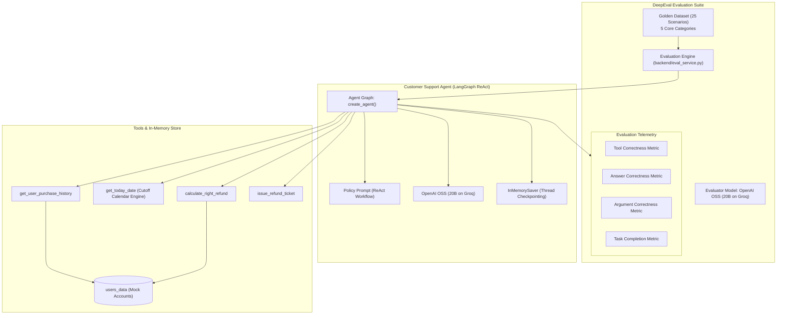

# AgentSentinel: Enterprise Agent Evaluation & Policy Guardrail Framework

AgentSentinel is an automated evaluation framework and regression testing harness for tool-calling LLM agents, built with **LangGraph**, **LangChain**, and **Confident AI DeepEval**.

The framework simulates an autonomous customer support refund specialist enforcing multi-variable business policies: customer identity lookup, 30-day cutoff validation, non-purchased item checks, and partial refund calculations. It decouples stochastic intent extraction from deterministic tool execution, verifying that agent actions remain strictly within corporate policy boundaries.

---

## Benchmark Results

Evaluation benchmark conducted across the complete 25-case Golden Dataset using **OpenAI OSS (20B)** via Groq high-throughput inference.

- **Benchmark Artifact:** [`agent_eval_benchmark_llama_2026-10-26_20-14-15.csv`](agent_eval_benchmark_llama_2026-10-26_20-14-15.csv)

### Summary Scorecard

| Metric | Result | Benchmark Standard | Status |
| :--- | :--- | :--- | :--- |
| **Total Test Cases** | **25 / 25** | Complete golden regression suite | Concluded |
| **Pass Rate** | **100% (25 / 25)** | All policy guardrails verified | PASSED |
| **Tool Correctness** | **100%** | Exact tools invoked in valid sequence | PASSED |
| **Answer Correctness** | **100%** | Responses logically align with policy rules | PASSED |
| **Argument Correctness** | **100%** | Accurate user IDs, item names, and calculated amounts | PASSED |
| **Task Completion** | **100%** | End-to-end task fulfillment | PASSED |
| **Financial Hallucination** | **0.0% (Zero)** | No fabricated transactions or unauthorized tickets | PASSED |
| **Average Latency** | **19,315 ms** | Stable multi-step ReAct reasoning loops | Optimal |

---

### Complete 25-Case Benchmark Telemetry

| # | Category | User Query | Key Policy Decision / Outcome | Tools Invoked | Result | Latency |
| :-: | :--- | :--- | :--- | :--- | :-: | :-: |
| 1 | Valid Refund | user123: refund book and pen | Approved full refund ($30 ticket issued) | 4 tools | PASS | 5,709 ms |
| 2 | Valid Refund | user123: refund book | Approved full refund ($23 ticket issued) | 4 tools | PASS | 3,162 ms |
| 3 | Valid Refund | sarah_m: return laptop_stand | Verified within 30-day window ($45 ticket issued) | 4 tools | PASS | 26,426 ms |
| 4 | Valid Refund | sarah_m: return laptop_stand + mouse | Approved multi-item refund ($70 ticket issued) | 4 tools | PASS | 31,748 ms |
| 5 | Valid Refund | chloe_d: refund backpack | Approved single-item refund ($55 ticket issued) | 4 tools | PASS | 29,697 ms |
| 6 | Valid Refund | priya_p: return desk_mat | Approved recent purchase ($22 ticket issued) | 4 tools | PASS | 22,317 ms |
| 7 | Valid Refund | david_k: return coffee_maker | Purchase on exact day-30 boundary approved ($80 ticket) | 4 tools | PASS | 34,433 ms |
| 8 | Policy Boundary | david_k: refund travel_mug | Day 31 boundary: Denied (exceeds 30-day window) | 2 tools | PASS | 23,197 ms |
| 9 | Valid Refund | alex_w: refund mechanical_keyboard | Approved within policy window ($110 ticket issued) | 4 tools | PASS | 24,145 ms |
| 10 | Policy Boundary | user126: refund water_bottle | Purchased 93 days ago: Denied (outside policy) | 2 tools | PASS | 15,058 ms |
| 11 | Policy Boundary | michael_b: refund smart_watch | Future date anomaly detected: Denied | 2 tools | PASS | 17,548 ms |
| 12 | Partial Eligibility | user126: backpack + water_bottle | Partial refund: Backpack approved ($45); bottle denied | 4 tools | PASS | 28,065 ms |
| 13 | Partial Eligibility | elena_r: tablet + stylus_pen | Partial refund: Stylus approved ($30); tablet denied | 4 tools | PASS | 26,344 ms |
| 14 | Partial Eligibility | alex_w: keyboard + keycap_set | Partial refund: Keyboard approved ($110); keycaps denied | 4 tools | PASS | 34,985 ms |
| 15 | Partial Eligibility | marcus_t: shoes + mat + water_bottle | Partial refund: Shoes + mat approved ($125); bottle denied | 4 tools | PASS | 34,495 ms |
| 16 | Partial Eligibility | chloe_d: backpack + unpurchased umbrella | Backpack approved ($55); unpurchased umbrella rejected | 4 tools | PASS | 21,404 ms |
| 17 | Informational | user123: inquiry on purchase history | Returned purchase breakdown table; no tickets issued | 1 tool | PASS | 6,968 ms |
| 18 | Informational | sarah_m: inquiry on order history | Returned itemized order summary; no tickets issued | 1 tool | PASS | 9,098 ms |
| 19 | Informational | marcus_t: inquiry on past purchases | Returned monthly purchase recap; no tickets issued | 1 tool | PASS | 5,037 ms |
| 20 | Informational | david_k: check travel_mug purchase | Confirmed order date (2026-09-25); no tickets issued | 1 tool | PASS | 11,891 ms |
| 21 | Negative Guardrail | user999: refund book | Unregistered user: Rejected; prompted for valid user | 1 tool | PASS | 12,902 ms |
| 22 | Negative Guardrail | ghost_user: order refund | Unregistered user: Rejected; prompted for valid user | 1 tool | PASS | 8,426 ms |
| 23 | Negative Guardrail | user126: refund sneakers | Unpurchased item: Verified history and rejected cleanly | 1 tool | PASS | 6,504 ms |
| 24 | Negative Guardrail | james_h: refund wireless_earbuds | Unpurchased item: Verified history and rejected cleanly | 1 tool | PASS | 10,155 ms |
| 25 | Policy Boundary | james_h: refund gaming_chair | Expired purchase (2026-07-15): Denied | 2 tools | PASS | 13,169 ms |

---

## System Architecture



---

## Evaluation Taxonomy & Metrics

### Evaluated Metrics

| Metric | Type | Pass Threshold | Definition |
| :--- | :--- | :--- | :--- |
| **Tool Correctness** | Tool Metric | `0.80` | Measures whether the agent called the exact expected sequence of tools. |
| **Answer Correctness** | Response Metric | `0.80` | Evaluates logical equivalence and policy outcome alignment against expected output. |
| **Argument Correctness**| Parameter Metric | `0.75` | Verifies extracted parameters (usernames, items, amounts) against ground truth. |
| **Task Completion** | End-to-End | `0.80` | Verifies the overarching business task was completely and safely fulfilled. |

### Dataset Categories (25 Scenarios)

1. **Happy Path Valid Refunds (Cases 1 to 7, 9):** Single and multi-item requests within the 30-day window.
2. **Policy Boundaries & Calendar Precision (Cases 8, 10, 11, 25):** 30-day cutoff boundaries, expired purchases, and future date anomaly detection.
3. **Partial Eligibility & Mixed States (Cases 12 to 16):** Requests containing combinations of eligible, expired, and unpurchased items.
4. **Informational Inquiries (Cases 17 to 20):** Order history requests where no refund action should be taken.
5. **Negative Guardrails (Cases 21 to 24):** Non-existent usernames and unpurchased items halting execution.

---

## Production Dashboards

The framework includes two independent, decoupled web interfaces:

### 1. Support Chat Console (`http://127.0.0.1:8001`)
* ReAct refund specialist agent powered by OpenAI OSS (20B).
* GFM Markdown table rendering for order histories and refund summaries.
* Session reset and thread checkpointing via LangGraph.

### 2. Evaluation Dashboard (`http://127.0.0.1:8002`)
* Server-Sent Events (SSE) live evaluation telemetry streaming.
* Real-time metric gauges for Tool Correctness, Answer Correctness, Argument Correctness, and Task Completion.
* Interactive case drawer modal for inspecting inputs, outputs, tool arguments, and execution latency.
* One-click **Download Benchmark (CSV)** exporting UTF-8 BOM formatted spreadsheets.

---

## Quick Start

### 1. Installation
```powershell
uv venv
.\.venv\Scripts\activate
uv pip install -e .
```

### 2. Environment Configuration
Create a `.env` file in the root directory (refer to `.env.example`):
```env
GROQ_API_KEY="your_groq_api_key_here"
LLAMA_MODEL="openai/gpt-oss-20b"
```

### 3. Launch Dashboards

```powershell
# Launch Customer Support Chat Console (Port 8001)
python run_chat.py

# Launch Evaluation Dashboard (Port 8002)
python run_evals.py
```

---

## Repository Structure

```text
Agent_Eval/
├── agent/                  # Agent core, ReAct tools, prompts, mock data
│   ├── agent.py            # LangGraph create_agent definition
│   ├── data.py             # Customer purchase database
│   ├── models.py           # Model initialization
│   ├── prompts.py          # Corporate refund policy instructions
│   └── tools.py            # ReAct tools (history, date, calculate, ticket)
├── backend/                # Decoupled FastAPI server services
│   ├── chat_app.py         # Chat console API server (Port 8001)
│   ├── chat_service.py     # Multi-turn chat session service
│   ├── eval_app.py         # Evaluation dashboard API server (Port 8002)
│   └── eval_service.py     # Live SSE benchmark telemetry engine
├── evaluations/            # DeepEval testing suites & dataset
│   ├── dataset.py          # 25 curated golden scenarios
│   ├── model.py            # Model configuration
│   └── eval_all.py         # CLI batch runner
├── frontend/               # Production dashboard interfaces
│   ├── chat/index.html     # Support chat console interface
│   ├── eval/index.html     # Live evaluation dashboard interface
│   ├── css/                # Tokenized CSS (Framer & Intercom design systems)
│   └── js/                 # Dashboard telemetry controllers & CSV export
├── run_chat.py             # Standalone runner for Port 8001
├── run_evals.py            # Standalone runner for Port 8002
├── agent_eval_benchmark_llama_2026-10-26_20-14-15.csv  # Benchmark artifact
└── pyproject.toml          # Project package configuration
```
