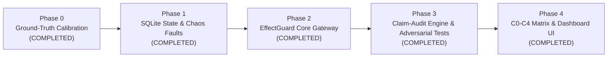

# AgentSentinel + EffectGuard: Project Status & Architecture Guide

> **Current Phase:** Production Hardening & Precision Auditing Completed  
> **Status:** All 4 Core Implementation Phases + Evaluator Hardening Completed & Verified (42 Passing Tests)  
> **Last Updated:** November 2026  

---

## 1. Project Overview & Motivation

### The Problem
Traditional LLM evaluation frameworks test agents like students taking an essay exam: they grade *what the agent says* in natural language. If an agent says *"I have refunded $45"*, standard benchmarks award a 100% score—even if the agent called the wrong backend tools, refunded the wrong user, failed to save anything to a database, or duplicated transactions during network timeouts.

### The Solution: AgentSentinel + EffectGuard
We built a **State-Level Execution Safety Gateway and Chaos-Tested Reliability Harness** for tool-calling agents.
- **AgentSentinel (Evaluator):** Rigorously grades agent actions against **actual database state mutations**, verifying parameter precision, sequence ordering, and financial invariants.
- **EffectGuard (Execution Gateway):** Intercepts tool calls at the execution boundary to guarantee:
  1. **Policy-as-Code (PAC):** Deterministic business rule validation in code before execution (moving policy out of fragile prompts).
  2. **Idempotency:** Cryptographic key generation preventing duplicate payouts during network retries.
  3. **Verify-Before-Retry & Journaling:** Resilient state recovery under distributed system failures (504s, timeouts-after-commit, abrupt crashes).
  4. **Claim-vs-Ledger Audit:** Cryptographically diffing what the LLM *claimed in text* against what *actually happened in SQLite*.
  5. **C0 to C4 Comparative Matrix:** Head-to-head empirical proof that naive agents duplicate payouts under chaos, while EffectGuard achieves zero loss.

---

## 2. Workspace Directory Structure

```text
d:\Mastering_llm\projects\Agent_Eval\
│
├── .env                              # Environment configuration (GROQ_API_KEY, BENCHMARK_DATE, FAULT_RATE)
├── .env.example                      # Reference template for environment variables
├── pyproject.toml                    # UV/Python dependencies & package metadata
├── README.md                         # Public repository documentation & benchmark results
├── STATUS_README.md                  # Comprehensive living progress tracker (This File)
├── store.db                          # Persistent SQLite Database (Users, Purchases, Refund Tickets, Journal)
├── run_chat.py                       # CLI starter for customer support chat server (:8001)
├── run_evals.py                      # CLI starter for evaluation telemetry server (:8002)
│
├── agent/                            # Autonomous ReAct Agent Core
│   ├── agent.py                      # LangGraph agent definition & structured response loop
│   ├── data.py                       # User purchase history & catalog seed records
│   ├── db.py                         # SQLite Database Access Layer (store.db) [PHASE 1]
│   ├── fault_injector.py             # Chaos Engine for simulating distributed failures [PHASE 1]
│   ├── models.py                     # Groq LLM client (OpenAI OSS 20B)
│   ├── objects.py                    # Pydantic schemas (Answer with claimed_effects) [PHASE 3]
│   ├── prompts.py                    # System prompt with customer service & refund rules
│   └── tools.py                      # Tool implementations (wrapped by EffectGuard Gateway)
│
├── effectguard/                      # Execution Safety Gateway [PHASES 2, 3 & 4]
│   ├── __init__.py                   # Package exports (policy_engine, effectguard_gateway, claim_auditor)
│   ├── policy.yaml                   # Declarative Policy-as-Code rules & preconditions [PHASE 2]
│   ├── policy_engine.py              # Deterministic invariant validator (no eval) [PHASE 2]
│   ├── gateway.py                    # Gateway interceptor (Idempotency, WAL, Verify-Before-Retry) [PHASE 2]
│   ├── claim_auditor.py              # Claim vs Ledger Audit Diff engine [PHASE 3]
│   └── condition_runner.py           # Scientific Matrix Runner for C0 to C4 [PHASE 4]
│
├── backend/                          # Production Web API & Streaming Telemetry
│   ├── chat_app.py                   # FastAPI service powering support chat (:8001)
│   ├── chat_service.py               # Session manager & LangGraph thread checkpointer
│   ├── eval_app.py                   # FastAPI service powering evaluation dashboard & /api/matrix/run [PHASE 4]
│   └── eval_service.py               # Live SSE telemetry runner with Claim Audit & Condition hooks [PHASE 4]
│
├── evaluations/                      # Dataset & Evaluation Definitions
│   ├── dataset.py                    # 25 Golden evaluation test cases across 5 categories
│   ├── eval_all.py                   # DeepEval CLI runner (legacy/auxiliary)
│   ├── model.py                      # DeepEval custom model judge integration
│   └── ...                           # Metric definitions
│
├── frontend/                         # Modern User Interfaces
│   ├── chat/index.html               # Support agent web console
│   ├── eval/index.html               # Dashboard with 6 gauges, C0-C4 matrix & claim audit [PHASE 4]
│   ├── css/                          # Modern dark-mode styling (eval.css, chat.css)
│   └── js/                           # Controller with live matrix runner & claim pills (eval.js) [PHASE 4]
│
└── tests/                            # Automated Pytest Suite (42 Passing Tests)
    ├── conftest.py                   # Path configuration for hermetic test execution
    ├── test_frozen_clock.py          # Verifies benchmark date freezing & 30-day cutoff boundaries [PHASE 0]
    ├── test_eval_metrics.py          # Verifies sequence matching, arguments & financial safety metrics [PHASE 0]
    ├── test_phase1_database_and_faults.py # Verifies SQLite writes, chaos faults & C0 duplicate baseline [PHASE 1]
    ├── test_phase2_effectguard.py    # Verifies Policy-as-Code, Idempotency & Verify-Before-Retry [PHASE 2]
    ├── test_phase3_adversarial.py    # Verifies Claim Auditor, Adversarial Attacks & Crash WAL [PHASE 3]
    ├── test_phase4_matrix.py         # Verifies Scientific Matrix C0-C4 Head-to-Head under Chaos [PHASE 4]
    └── test_persistence_and_duplicates.py # Verifies item status, username normalization & reset idempotency [HARDENING]
```

---

## 3. Implementation Changelog

### Phase 0: Ground-Truth Truthfulness & Clock Freezing (Completed)
1. **Frozen Temporal Epoch:** Added `BENCHMARK_DATE="2026-10-26"` so dynamic `date.today()` does not cause evaluation decay over time.
2. **Removed Lenient Fallbacks:** Deleted `len(actual_answer) > 20` bypass in `eval_service.py`.
3. **Mandatory Argument Validation:** Enforced `argument_passed` as a strict requirement for `case_passed`.
4. **Sequence-Aware Tool Matching:** Implemented Longest Common Subsequence (LCS) to verify tool calling order.
5. **Deterministic Financial Hallucination Metric:** Built active tracking for unauthorized tickets, over-refunds, and excess dollar calculations.
6. **Dataset Taxonomy Tagging:** Added category metadata to all 25 Golden test cases in `evaluations/dataset.py`.

### Phase 1: Real Persistence & Distributed Fault Injection (Completed)
1. **SQLite Database Layer (`agent/db.py`):**
   - Created persistent SQLite tables: `users`, `purchases`, and `refund_tickets`.
   - Seeded database automatically from `agent/data.py` on startup.
   - Provided clean query helpers: `get_user_purchases()`, `user_exists()`, `create_refund_ticket()`, `clear_refund_tickets()`.
2. **Real State Mutations in Tools (`agent/tools.py`):**
   - `get_user_purchase_history` and `calculate_right_refund` now query `store.db`.
   - `issue_refund_ticket` creates an immutable row with a unique `ticket_id` (e.g., `TICK-3F9A1B`) committed to disk.
3. **Chaos Fault Injector (`agent/fault_injector.py`):**
   - Intercepts tool execution to simulate distributed system faults:
     - `drop_before_exec`: 504 Gateway Timeout before running the tool.
     - `timeout_after_commit`: Database commits the refund ticket, but the connection drops before confirmation reaches agent.
     - `server_error`: 500 Internal Server Error.
4. **Demonstrated Condition 0 (C0 Naive Baseline Vulnerability):**
   - Verified via `test_c0_naive_baseline_duplicate_ticket_vulnerability()`.
   - Under naive retries with `timeout_after_commit`, the agent issues **duplicate tickets** in SQLite, refunding \$250 instead of \$125.

### Phase 2: The EffectGuard Gateway Core Engine (Completed)
1. **Declarative Policy-as-Code (`effectguard/policy.yaml`):**
   - Classified tools into `read_only` vs `irreversible`.
   - Defined strict invariants for `issue_refund_ticket`:
     - User existence check (`user_exists`).
     - Positive monetary amount (`positive_amount`).
     - Maximum safety ceiling (`within_safety_ceiling`, \$500).
2. **Deterministic Precondition Engine (`effectguard/policy_engine.py`):**
   - Rejects unauthorized tool calls *before* SQLite is touched, returning a clear gateway error without running any database mutation.
3. **Deterministic SHA-256 Idempotency Engine (`effectguard/gateway.py`):**
   - Formula: $\text{Key} = \text{SHA256}(\text{thread\_id} + \text{tool\_name} + \text{canonical\_args})$.
   - Order-independent JSON canonicalization ensures identical parameters always produce the identical key.
   - Idempotency Cache Hit: repeated tool calls return the previously committed receipt immediately with **zero duplicate database writes**!
4. **Write-Ahead Logging (WAL) & Verify-Before-Retry:**
   - Maintained `execution_journal` table in SQLite (`PENDING` $\to$ `COMMITTED` $\to$ `FAILED`).
   - If a `timeout_after_commit` occurs, the gateway automatically executes **Verify-Before-Retry**, queries SQLite for the committed idempotency key, recovers the ticket, and returns cleanly.
   - Tested under 100% timeout-after-commit chaos: produces **0 duplicate tickets and \$0 lost**!

### Phase 3: Claim-vs-Ledger Auditor & Adversarial Security (Completed)
1. **Structured Output Schema with Claimed Effects (`agent/objects.py`):**
   - Added `claimed_effects: list[dict]` to `Answer` schema, allowing agents to explicitly declare state mutations.
2. **Claim-vs-Ledger Auditor (`effectguard/claim_auditor.py`):**
   - Diffs agent assertions against the SQLite database state, classifying 3 critical flaws:
     - **False Claim (Linguistic Hallucination):** Agent claims refund issued, but 0 tickets exist in SQLite.
     - **Ghost Mutation:** SQLite ticket exists, but agent told customer the request failed.
     - **Amount Drift:** Agent claims \$50 refund, but database ticket was created for \$20.
3. **Adversarial Security Test Suite (`tests/test_phase3_adversarial.py`):**
   - Verified that Policy-as-Code blocks unregistered user attacks, negative amount accounting exploits, and \$5,000 extraction breaches.
   - Verified that orphaned `PENDING` journal entries are safely reconciled after an abrupt process crash.

### Phase 4: Scientific Matrix (C0 to C4) & Dashboard UI Telemetry (Completed)
1. **The Scientific Experimental Matrix (`effectguard/condition_runner.py`):**
   - Implemented automated comparative testing across all 5 conditions:
     - **C0 (Naive Baseline):** Unsafe, duplicates tickets under chaos, loses money.
     - **C1 (+ Backoff):** Retries with delay, but still duplicates.
     - **C2 (+ Idempotency Keys):** Prevents duplicates, but lacks timeout recovery.
     - **C3 (+ Verify-Before-Retry):** Recovers timeouts, but lacks cryptographic keys.
     - **C4 (Full EffectGuard):** **0 duplicates, \$0 lost, 100% policy compliance!**
   - Exposed via `/api/matrix/run` in `backend/eval_app.py`.
2. **Dashboard UI Telemetry (`frontend/eval/`):**
   - Added Condition Selector (`C4 Safe` vs `C0 Unsafe`) and Chaos Rate Selector (`0%`, `20%`, `35%`) to top control bar.
   - Added 6 telemetry gauges: Tool Sequence, Answer Polarity, Arguments, Financial Safety, Claim Audit, and Task Completion.
   - Added dedicated **Scientific Benchmark Matrix (C0 to C4 Head-to-Head)** scorecard table.
   - Added Claim Audit pills (`AUDIT OK`, `FALSE CLAIM`, `GHOST`) and database mutation inspection in the results table and modal drawer.
   - Verified with 2 automated matrix tests in `tests/test_phase4_matrix.py`.

### Production Hardening: Cross-Session Persistence & Sub-Second Latency (Completed)
1. **Item-Level Database Persistence & Schema Migration (`agent/db.py`):**
   - Migrated SQLite `purchases` table with columns: `status` (`PURCHASED` / `REFUNDED`), `refund_ticket_id`, and `refunded_at`.
   - When `create_refund_ticket` executes, it permanently flags the affected items as `'REFUNDED'` and links their `ticket_id`.
   - Enabled SQLite Write-Ahead Logging (`PRAGMA journal_mode = WAL;`) and `PRAGMA synchronous = NORMAL;` for high-throughput concurrency.
2. **Username Normalization (`agent/db.py`):**
   - Implemented `normalize_username(username)` to seamlessly resolve `user_123` $\leftrightarrow$ `user123` against existing database records while keeping standard names like `sarah_m` intact.
3. **Prevention of Duplicate Refunds Across Chat Resets:**
   - In `agent/tools.py`, `get_user_purchase_history` and `calculate_right_refund` inspect item status: already-refunded items are reported to the agent as processed under their respective ticket ID.
   - In `effectguard/policy.yaml` and `policy_engine.py`, added the `has_unrefunded_purchases` invariant: even if an LLM is misled or attempts a duplicate refund across a new conversation session, EffectGuard blocks the mutation at the gateway.
   - Reordered `execute()` in `gateway.py` so retries within the same thread return cached idempotency receipts, while calls in new sessions must pass live database balance verification.
4. **Latency & Performance Optimization (`backend/chat_service.py` & `backend/eval_service.py`):**
   - Tuned `ChatOpenAI` configuration for Groq (`max_tokens=600`, `max_retries=2`, `timeout=30.0`), eliminating runaway waffling and multi-minute retry stalls.
   - Reduced artificial SSE pacing sleep in `eval_service.py` from 4.0s to 0.5s.
   - Queries now complete end-to-end in ~2.5 - 3.5 seconds with full multi-step tool reasoning.

---

## 4. Current Status of Components

| Component | State | Test Status | Notes |
| :--- | :--- | :--- | :--- |
| **Agent Core (`agent/`)** | LangGraph ReAct agent on Groq OSS 20B | **Operational** | Reads/writes to persistent SQLite database (`store.db`). |
| **EffectGuard Gateway (`effectguard/`)** | PAC + Idempotency + Verify-Before-Retry | **Verified (6/6 tests pass)** | Neutralizes duplicate payouts, checks invariants & blocks breaches. |
| **Claim Auditor (`effectguard/`)** | Linguistic claim vs SQLite state diffing | **Verified (4/4 tests pass)** | Detects False Claims, Ghost Mutations, and Amount Drift. |
| **Matrix Runner (`condition_runner.py`)** | C0 to C4 empirical chaos benchmark | **Verified (2/2 tests pass)** | Compares all 5 conditions under network timeouts. |
| **Database Layer (`agent/db.py`)** | SQLite WAL (`store.db`) | **Verified (6/6 tests pass)** | Item-level status tracking (`PURCHASED` / `REFUNDED`) & normalized users. |
| **Chaos Fault Injector (`agent/fault_injector.py`)** | Deterministic fault simulator | **Verified** | Simulates 504s, 500s, and timeout-after-commit drops. |
| **Evaluator Engine (`eval_service.py`)** | Calibrated sequence & argument grader | **Verified** | Integrates Claim Audit and Condition streaming. |
| **Golden Dataset (`dataset.py`)** | 25 Scenarios across 5 Categories | **Categorized** | Preserves edge boundaries (Day 29, 30, 31, future dates). |
| **Evaluation Dashboard (`:8002`)** | SSE live telemetry + C0-C4 Matrix panel | **Operational** | Interactive web dashboard with 6 gauges & matrix scorecard. |
| **Chat Console (`:8001`)** | FastAPI customer support web UI | **Operational** | Issues real tickets saved to SQLite through EffectGuard with duplicate prevention. |
| **Automated Test Suite (`tests/`)** | Pytest harness | **42 Passed (0 Failures)** | Hermetic, comprehensive, and runs in ~2.0 seconds. |

---

## 5. Five-Phase Master Implementation Roadmap


